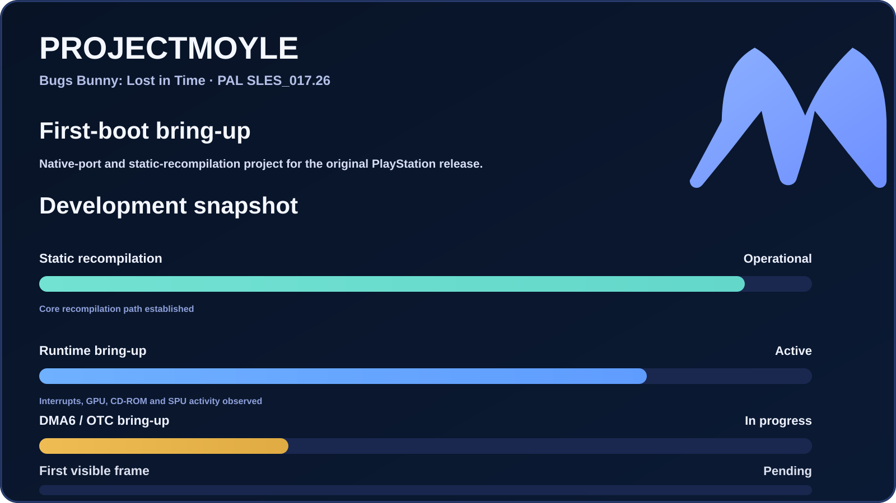

# ProjectMoyle

[](https://github.com/r4tchwx/ProjectMoyle/actions/workflows/ci.yml)
[](LICENSE)


ProjectMoyle is a title-focused native-port project for
**Bugs Bunny: Lost in Time** for the original PlayStation.

The project explores static recompilation, PlayStation runtime behavior,
and native-platform infrastructure with the long-term goal of running the
original game on modern systems while preserving its behavior.

> [!IMPORTANT]
> **Development status**
>
> ProjectMoyle is under active development. The current focus is first-boot
> bring-up of the PAL `SLES_017.26` release through static recompilation and
> a native PlayStation runtime.

## Project status



The status card reports qualitative subsystem readiness rather than an
overall completion percentage.

The latest first-boot probe executed **245,695,024 guest instructions**,
observed **725 VBlank edges**, completed **460 GPU uploads**, and delivered
**517 CD sectors**. GPU, CD-ROM, SPU and interrupt activity are already
present; current bring-up work is focused on the DMA6 / OTC path.

A visible game frame has **not** been reached yet.

> [!NOTE]
> **AI-assisted development**
>
> ProjectMoyle is developed with the assistance of AI tools.
>
> AI is used during development for engineering, analysis, testing,
> research, documentation, and related tasks.
>
> Changes are reviewed and validated before being accepted into the project.

> [!WARNING]
> **Original game data**
>
> ProjectMoyle does not distribute the original game, disc images,
> executables, extracted assets, BIOS files, or other proprietary game data.
>
> Where original game data is required, users must provide their own
> legally obtained copy.

## Public source

This public repository contains reviewed ProjectMoyle-authored
infrastructure considered suitable for redistribution.

Development material that directly depends on reverse-engineered game code,
executable-derived data, or material requiring additional redistribution
review is maintained separately and is not included here.

## Development approach

ProjectMoyle develops title-focused recompilation tooling and runtime
components to study and reproduce the behavior required by the target title.

External technical documentation and reference projects that contribute
useful knowledge to the project are acknowledged in
[REFERENCES.md](REFERENCES.md).

Third-party code, when incorporated, must be separately identified together
with its applicable license and attribution. See
[THIRD_PARTY_NOTICES.md](THIRD_PARTY_NOTICES.md).

## Provenance

The public repository is intentionally separated from the private
development archive used during reverse engineering and research.

See [PROVENANCE.md](PROVENANCE.md).

## Building

ProjectMoyle currently requires:

- CMake 3.20 or newer
- a C++20-compatible compiler
- a supported build backend such as Ninja

Example:

```powershell
cmake -S . -B build -G Ninja -DCMAKE_BUILD_TYPE=Release
cmake --build build
ctest --test-dir build --output-on-failure
```

The initial public source set contains only tests that use synthetic or
redistributable data.

Some development tests used by the private research archive require
separately reviewed fixtures or original game data and are intentionally
not included here.

## License

ProjectMoyle-authored code in this repository is licensed under the
[MIT License](LICENSE) unless otherwise stated.

This license does not grant rights to **Bugs Bunny: Lost in Time**, its
assets, trademarks, original executable code, or any other third-party
intellectual property.
